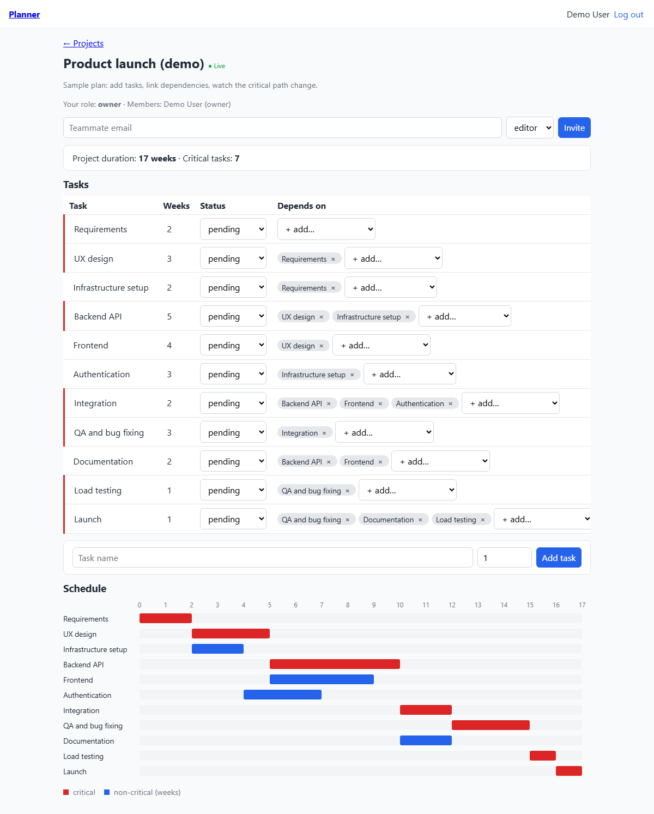
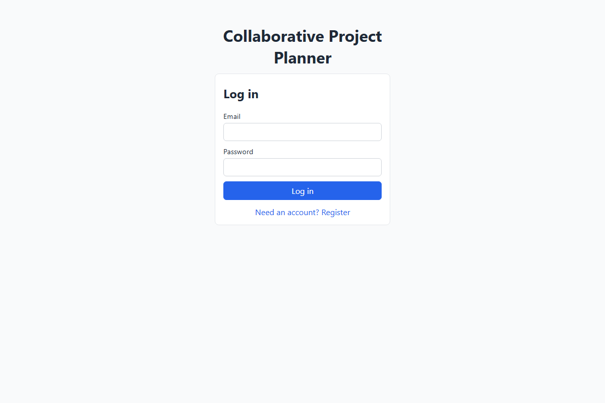
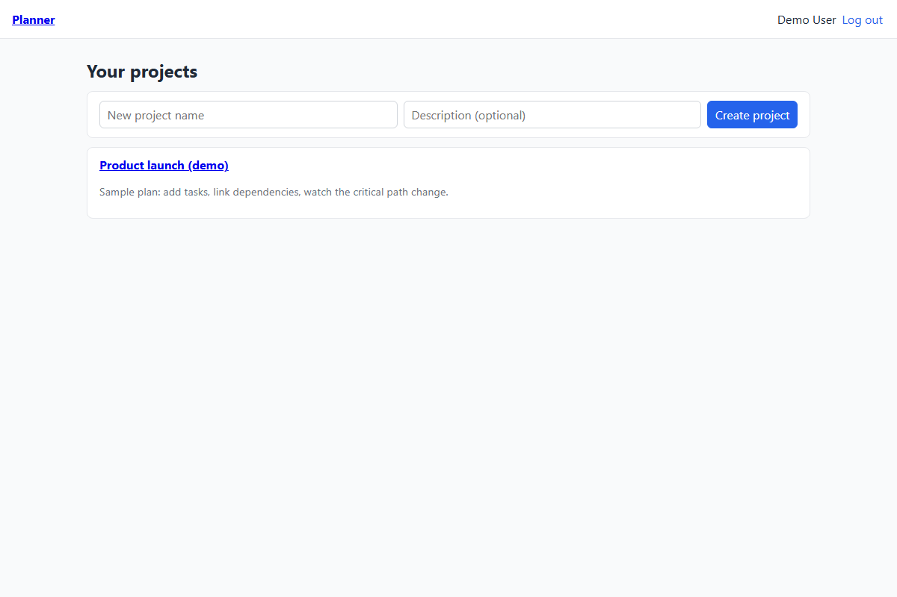
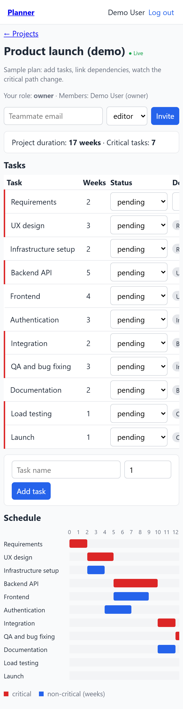

# Collaborative Project Planner

[](https://github.com/MillyDzukou/Collaborative-Project-Planner/actions/workflows/ci.yml)

A real-time collaborative project planner. A team builds a plan as tasks and dependencies; the app computes the
**critical path** (the chain of tasks that sets the project's duration) and every change shows up live on
teammates' screens, with explicit conflict handling when two people edit the same task.

> **Live demo:** not deployed yet. Deployment is prepared and rehearsed locally ([`docs/deployment.md`](docs/deployment.md))
> but nothing has been put on a real host, so there is no live link. Run it locally in 5 minutes (below).
> **Demo video:** not recorded yet; the script is in [`docs/demo-script.md`](docs/demo-script.md).



<table>
  <tr>
    <td></td>
    <td></td>
    <td></td>
  </tr>
</table>

## What it does

- **Plan:** projects with tasks (name, duration in weeks, status) and finish-to-start dependencies. Cycles, self-dependencies
  and cross-project dependencies are rejected.
- **Critical path:** early/late start and finish, float and project duration computed with the Critical Path Method,
  shown as a table and a Gantt chart with critical tasks highlighted.
- **Collaborate:** invite registered users as **owner / editor / viewer**; viewers see everything and can change nothing.
- **Live:** edits appear on other members' screens within about a second, with a connection indicator.
- **Safe concurrent editing:** every edit carries the version it was based on; if someone saved first, the editor gets a
  "changed by someone else" banner with *reapply my change* / *keep their version* instead of silently overwriting.

Not in v1: email notifications, file uploads, a native mobile app, resource levelling. See [Known limitations](#known-limitations).

## Quick start (about 5 minutes)

Requires only Docker. Building the images the first time takes a few minutes.

```bash
cp .env.example .env
docker compose up --build -d
docker compose exec -T api npm run migrate:up                              # create the tables
docker compose exec -T -e DEMO_PASSWORD='pick-a-long-password' api npm run seed:demo   # optional demo account + sample plan
```

- Web app: http://localhost:5173 &nbsp;·&nbsp; API health: http://localhost:4000/health
- Demo login: `demo@planner.example` with the password you chose (a sample 11-task plan with a 17-week critical path).
- Or just click **Register** and make your own account (password of at least 10 characters).
- Stop with `docker compose down` (add `-v` to also delete the database).

To see live collaboration, register a second user, invite them from the first user's project (owner → "Teammate email"),
and open the project in two browsers.

## Documentation

| | |
|-|-|
| [`docs/architecture.md`](docs/architecture.md) | System diagram, life of an edit, components, design decisions and trade-offs, security model |
| [`docs/openapi.yaml`](docs/openapi.yaml) | Every REST endpoint, request/response shape and error code (OpenAPI 3; a test fails if it drifts from the code). Open it in any Swagger/OpenAPI viewer, e.g. [editor.swagger.io](https://editor.swagger.io) |
| [`docs/er-diagram.md`](docs/er-diagram.md) | Database entity-relationship diagram |
| [`docs/deployment.md`](docs/deployment.md) | Production images, environment variables, Render Blueprint, release checklist |
| [`load/README.md`](load/README.md) | k6 load tests, `EXPLAIN ANALYZE`, measured results and caveats |
| [`docs/ai-build-guide.md`](docs/ai-build-guide.md) | How each step was built with Claude Code (worktrees, subagents, MCP) |
| [`docs/demo-script.md`](docs/demo-script.md) | 2-minute demo walkthrough |
| [`docs/interview-prep.md`](docs/interview-prep.md) | 5-minute walkthrough, stories, résumé bullets and Q&A, with what you can and can't claim |

## Tech stack

| Layer | Choice |
|-------|--------|
| Frontend | React + Vite + TypeScript, React Query |
| Backend | Express + TypeScript, zod, argon2, pino |
| Database | PostgreSQL (versioned SQL migrations with node-pg-migrate) |
| Messaging | Redis pub/sub for WebSocket fan-out across API instances |
| Tests | Vitest + supertest (real Postgres/Redis), Playwright, k6 |
| Runtime | Docker / Docker Compose; nginx in front of the API in production images |

## Design decisions

The full table with trade-offs is in [`docs/architecture.md`](docs/architecture.md). The headline ones:

- **PostgreSQL**, not a document store: the data is relational and benefits from foreign keys and constraints.
- **Optimistic concurrency** (a `version` column) instead of row locking or CRDTs. Every `PATCH /tasks/:id` carries the
  `version` the client last saw, and the write is one atomic statement:
  `UPDATE tasks SET ..., version = version + 1 WHERE id = $1 AND version = $2`. Zero rows updated means someone else got
  there first, so the API answers `409 version_conflict` with the current task and the UI lets a human pick the winner.
  Row locks would be held for as long as a person thinks (or abandoned when a tab closes); CRDTs would merge edits
  automatically, but that machinery (and its unintuitive merges) is overkill for small field-level edits. The trade-off:
  a losing writer has to retry. A test fires ten simultaneous updates from the same version and asserts exactly one wins.
- **Redis pub/sub** so API instances stay stateless: any instance can accept a write and every instance forwards the
  event to its own WebSocket clients. Events say "something changed"; clients refetch through the normal (permission-checked) REST path.
- **Scheduling as a pure function** (`computeSchedule`), independent of Express and Postgres, so it is trivial to unit test.
- **Same-origin production topology:** nginx serves the SPA and proxies `/api` (and WebSockets) to the API so the `SameSite=Lax`
  auth cookie works on any hosting domain.

## Tests and CI

| Layer | Tool | Run |
|-------|------|-----|
| API unit + integration (real Postgres/Redis) | Vitest + supertest | `cd api && npm test` (use the `planner_test` DB, see `CLAUDE.md`) |
| WebSocket integration | Vitest + ws | included in `npm test` |
| API docs drift check | Vitest + swagger-parser | included in `npm test` |
| Lint / type-check | ESLint, `tsc` | `npm run lint`, `npx tsc --noEmit` in `api/` and `web/` |
| End-to-end (browser) | Playwright | `cd web && npm run e2e` against the running stack (see `web/e2e/README.md`) |
| Load | k6 | see [`load/README.md`](load/README.md) |

GitHub Actions (`.github/workflows/ci.yml`) runs on every push to `main` and every PR: API (lint, type-check, migrate,
test, build, production `npm audit`), web (lint, build), then e2e (brings the stack up with Docker Compose and runs
Playwright). It is green on GitHub as of commit `4d4bf52` ([run 44420693138](https://github.com/MillyDzukou/Collaborative-Project-Planner/actions/runs/44420693138)). The first two runs failed on two CI-only bugs that local runs could not show, both fixed: an API lockfile generated on Windows that lacked the Linux optional packages (so `npm ci` on Linux skipped a package Vitest needs), and the e2e job installing web dependencies after Docker had created a root-owned `web/node_modules` (npm `EACCES`, exit code 243).

## Real-time

After each successful write the API publishes `{type, projectId, payload, version}` to the Redis channel `project:<id>`;
every API instance subscribes to the channels of its connected clients and forwards messages over WebSocket
(`/ws?projectId=N`, authenticated with the same cookie as REST, members only). To prove fan-out across instances:

```bash
docker compose --profile scale up -d api2     # second API on :4001
docker compose exec -T api node scripts/fanout-check.mjs http://localhost:4000 http://api2:4000
```

## API hardening

- **Rate limiting (per IP, in memory per instance):** 600 requests/min globally (`RATE_LIMIT_GLOBAL`); `POST /auth/login`
  allows 10 *failed* attempts per 15 min; `POST /auth/register` 10/hour (`RATE_LIMIT_REGISTER`). Over the limit → `429 rate_limited`.
  Set `TRUST_PROXY` to the number of reverse-proxy hops when deployed so the real client IP is used.
- **Headers/CORS:** `helmet`; CORS and the WebSocket `Origin` check use the `WEB_ORIGIN` allow-list only.
- **Errors:** every failure is `{ error: { code, message } }` from one central handler; 5xx never leaks internals.
  Malformed JSON → 400, bodies over 100 kB → 413, unknown route → 404.
- **Validation:** all inputs validated with length caps (passwords ≤ 128 characters to bound argon2 work).
- **Logging:** structured `pino` logs with a request id (`X-Request-Id`) and the effective client IP; cookies are redacted.
- **Pagination:** `/projects`, `/projects/:id/tasks` and `/projects/:id/members` take `?limit=` (default 50, max 200) and `?offset=`.
- **Shutdown:** SIGTERM/SIGINT drain requests, close WebSockets, then Postgres and Redis (10 s hard limit).
- **Secrets:** the API refuses to start in production with the default `JWT_SECRET`. `npm audit --omit=dev` is clean.

## Load testing

k6 scripts, a bulk-data seed and `EXPLAIN ANALYZE` queries live in [`load/`](load/README.md). Measured on one laptop with
everything in Docker (production API image, one instance, 50k users / 200k memberships / 1M tasks):

| | Before | After |
|-|--------|-------|
| Bottleneck | `GET /projects` seq-scanned `project_members` (no index on `user_id`) | `idx_project_members_user_id`: 20.4 ms → 0.24 ms per query |
| p95: list projects / list tasks / patch task | 433 / 802 / 508 ms | **106 / 219 / 252 ms** |
| Errors | 0.02% | **0%** |

WebSockets: 1,000 simultaneous authenticated connections with zero failures (1,000 is what was tried, not a ceiling),
REST-write → WebSocket latency median 18 ms / p95 477 ms. Load testing also exposed a lockout bug in the login rate limiter,
now fixed with a regression test. Each figure is a single run on a laptop, and run-to-run noise is large (see `load/README.md`).

## Known limitations

Product:
- **Dependencies are finish-to-start only**, durations are whole weeks, and the Gantt shows week offsets, not calendar dates.
  No resource levelling, baselines or progress tracking beyond a free-text status.
- **The UI is narrower than the API:** you can invite members but not change roles or remove members from the UI (the API supports
  both), and tasks' assignee and cost, and project rename/delete, are API-only.
- **Invitations require an existing account;** there are no email invites, notifications, password reset or email verification.
- **No offline editing:** events missed while a client is disconnected are recovered by a full refetch on reconnect, not replayed.
- **Conflict handling covers task fields only;** dependency edits are not versioned (they are idempotent add/remove operations).

Technical:
- **Sessions are stateless 1-hour JWTs:** logout clears the cookie but cannot revoke a token that was already copied, and there is
  no refresh flow.
- **Rate-limit counters live in each API process's memory,** so with several instances the limits apply per instance, not globally
  (moving them to Redis is the next step).
- The schedule is recomputed on every request and the dependency list is not paginated; both were fine at the tested sizes only.
- Rate limits count logins on arrival, so more than about 10 *simultaneous* logins from one IP get a `429` until some finish.

Process / verification:
- **Not deployed.** The Render Blueprint, `TRUST_PROXY=2`, HTTPS cookies and real client IPs are unverified until a real deploy.
- Load numbers come from a single laptop; the 30-task coursework network used as a scheduling benchmark in the build guide is not in
  this repository (the scheduler is unit-tested on chains, branches, a diamond and a synthetic 9-task graph; the seeded 11-task
  demo plan was checked by hand, not by an automated test).
- A few argon2-heavy test hooks can time out on a heavily loaded machine; re-run if you see "Hook timed out".

## Folder structure

```
.
├── docker-compose.yml        # dev stack: postgres, redis, api (hot reload), web (Vite)
├── docker-compose.prod.yml   # production-like rehearsal: prod images, nginx proxy, migrations as a release step
├── docker-compose.load.yml   # overlay for load testing (production api image, rate limits off)
├── render.yaml               # Render Blueprint (written, not yet applied to a real account)
├── api/                      # Express + TypeScript backend
│   ├── src/{auth,projects,tasks,scheduling,realtime,http,db}/  # see docs/architecture.md
│   ├── migrations/           # versioned SQL migrations
│   ├── tests/                # unit + integration tests (Vitest)
│   └── Dockerfile            # multi-stage: dev / build / prod (prod must stay last)
├── web/                      # React + Vite frontend
│   ├── src/{pages,components,hooks,api}/
│   ├── e2e/                  # Playwright tests
│   ├── nginx/                # production proxy config template
│   └── scripts/              # screenshot generator for this README
├── load/                     # k6 scripts, bulk seed, EXPLAIN ANALYZE, results
└── docs/                     # architecture, openapi, er-diagram, deployment, screenshots, build guide
```

## Status

Everything in steps 1–16 of the build guide that can be done without a hosting account is done: scope, infrastructure, database, authentication, projects and permissions, tasks and
dependencies, CPM scheduling, the React frontend, real-time updates, edit-conflict handling, API hardening, tests and CI, load
testing, deployment preparation, and documentation. **Not yet done:** a real deployment (needs your hosting account and
secrets), a live link, and the demo video. Step 16 (interview preparation) is written up in
[`docs/interview-prep.md`](docs/interview-prep.md).
