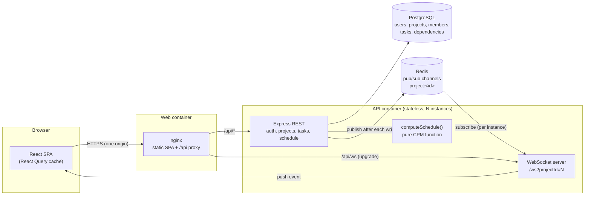
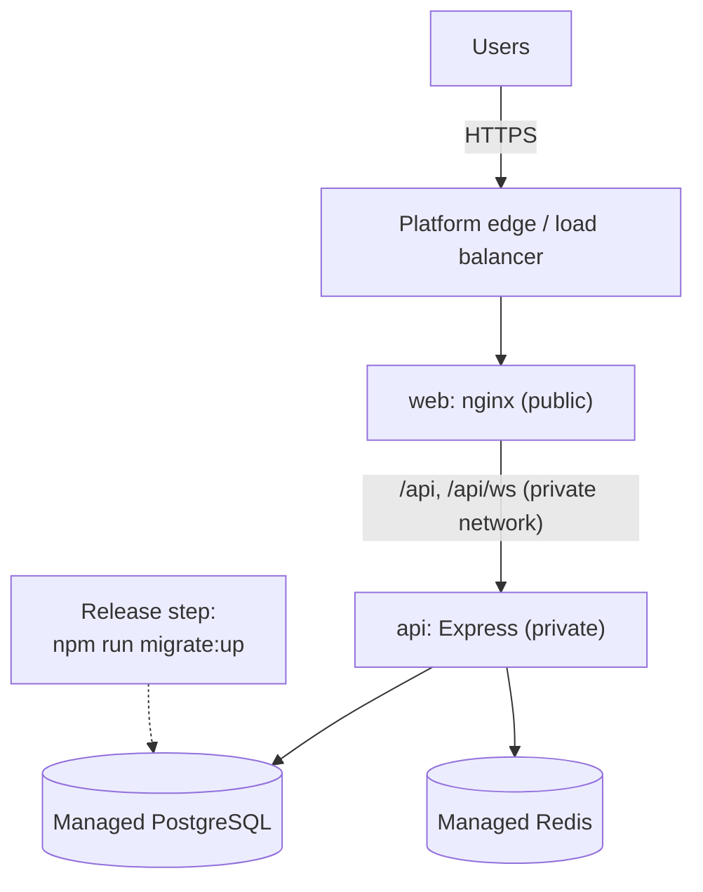

# Architecture

## System overview



## Life of an edit (why it is live and safe)

```mermaid
sequenceDiagram
  autonumber
  participant A as Browser A (editor)
  participant API1 as API instance 1
  participant PG as PostgreSQL
  participant R as Redis
  participant API2 as API instance 2
  participant B as Browser B (viewer)

  A->>API1: PATCH /tasks/42 {version: 3, duration_weeks: 5}
  API1->>API1: cookie -> user; role check (canPerform write)
  API1->>PG: UPDATE tasks SET ..., version = version + 1<br/>WHERE id = 42 AND version = 3
  alt row updated
    PG-->>API1: 1 row (version 4)
    API1->>R: PUBLISH project:7 {type: task.updated, version: 4}
    API1-->>A: 200 {task}
    R-->>API1: message
    R-->>API2: message
    API2-->>B: WebSocket {type: task.updated}
    B->>API2: refetch tasks, dependencies, schedule
  else zero rows (someone else saved first)
    PG-->>API1: 0 rows
    API1-->>A: 409 version_conflict {details.current}
    A->>A: banner: reapply my change / keep theirs
  end
```

The API instances hold no session or room state of their own beyond their open sockets, so any instance can
accept the write and every instance forwards it to the clients connected to it (Redis pub/sub is the bus).

## Components

| Component | Where | Responsibility |
|-----------|-------|----------------|
| Auth | `api/src/auth` | register/login/logout/me; argon2 hashing; 1-hour JWT in an `httpOnly`, `Secure`, `SameSite=Lax` cookie; identical error for wrong email vs wrong password |
| Projects & permissions | `api/src/projects` | project CRUD, members, roles. One function, `canPerform(role, action)`, decides everything and runs on every request; non-members get `404`, not `403` |
| Tasks & dependencies | `api/src/tasks` | CRUD, finish-to-start dependencies, cycle detection (DFS), cross-project and self-dependency rejection, optimistic concurrency via a `version` column |
| Scheduling | `api/src/scheduling` | `computeSchedule(tasks, dependencies)`: Kahn topological sort, forward pass (ES/EF), backward pass (LS/LF), float, critical flag. No DB or HTTP imports, so it is unit-tested in isolation |
| Real-time | `api/src/realtime` | cookie-authenticated WebSocket, members-only rooms, Origin allow-list, Redis fan-out, graceful shutdown |
| HTTP plumbing | `api/src/http`, `api/src/logger.ts` | rate limiting, central error handler (`{error:{code,message}}`), pagination, pino logging with request IDs |
| Web app | `web/src` | React + React Query; task table with inline editing, dependency chips, Gantt view, conflict banner, live-connection badge |

Data model: see [`er-diagram.md`](er-diagram.md). Every request path and error code: [`openapi.yaml`](openapi.yaml).

## Design decisions and trade-offs

| Decision | Why | Cost / alternative |
|----------|-----|--------------------|
| PostgreSQL, not a document store | The data is relational; foreign keys, unique and check constraints (no self-dependency, one membership per user per project) enforce integrity in the database | Schema migrations instead of schemaless flexibility |
| Optimistic concurrency (`version` column) | No locks held while a person thinks; the conflict is explicit (`409` with current state) and the UI lets a human choose the winner | A losing writer must retry. CRDTs would merge automatically but are overkill for small field-level edits |
| Redis pub/sub for fan-out | Keeps API instances stateless and horizontally scalable; any instance can originate an event | Pub/sub is fire-and-forget: a client that is offline misses events, so the web app refetches everything on reconnect |
| WebSocket pushes "something changed", client refetches | One source of truth (the REST read path, with permissions already enforced); no event-replay or merge logic on the client | Extra requests per event; scoped to only the affected queries to limit them |
| Same-origin deployment (nginx proxies `/api`) | The auth cookie is `SameSite=Lax`; two subdomains of a hosting provider's domain are cross-site, which would drop it | One more hop (nginx) in front of the API; `TRUST_PROXY` must match the number of proxies |
| Scheduling as a pure function | Trivial to test (chains, parallel branches, diamond, cycle rejection); independent of Express and Postgres | The schedule is recomputed on each request rather than cached (fine at the tested sizes, see `load/README.md`) |
| Rate limiting counts login failures on arrival | Cuts a flood of parallel guesses off immediately | More than ~10 *simultaneous* logins from one IP get a `429` until some finish |

## Security model

- **Authentication:** argon2 password hashes; the JWT lives only in an `httpOnly` cookie (not readable by JavaScript).
- **Authorization:** checked server-side on every request through `canPerform`; the UI hiding buttons is a convenience, not a control.
- **Existence is not leaked:** non-members receive `404` for projects and tasks, and the same on WebSocket upgrade.
- **Browser-side:** helmet headers on the API, a CSP and frame/referrer headers on the SPA, a CORS and WebSocket `Origin` allow-list of `WEB_ORIGIN` only.
- **Abuse limits:** per-IP rate limits (strict on login/register), request body capped at 100 kB, length caps on every input.
- **Secrets:** read from the environment only; the API refuses to start in production with the default `JWT_SECRET`.

## Deployment topology



Details, environment variables and the release checklist: [`deployment.md`](deployment.md). Nothing has been deployed yet.
