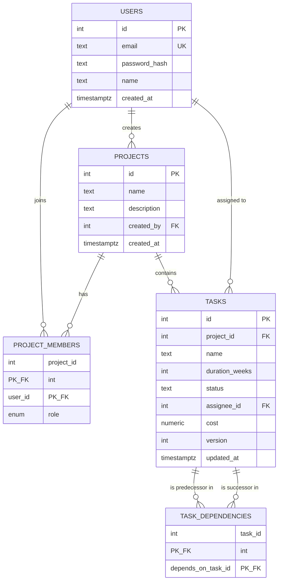

# Entity-relationship diagram

`task_dependencies` is finish-to-start: a task cannot start until every task it
depends on has finished. The `(task_id, depends_on_task_id)` pair is the
primary key (so a dependency can't be duplicated) and `task_id <>
depends_on_task_id` is enforced by a check constraint (no self-dependency).
Cycle detection across multiple tasks happens in application code (Step 6), not
the database.
